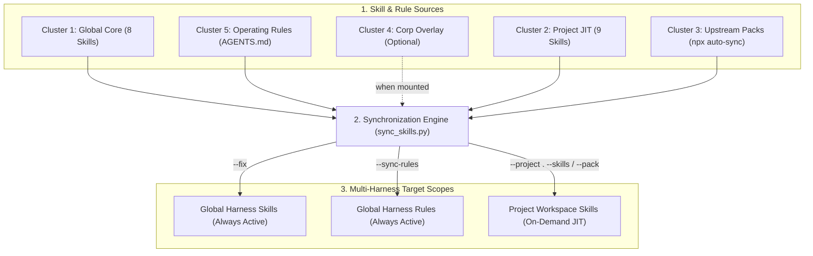

# `fde-agent-kit` — Forward Deployed Engineering Agent Skill Forge

A portable, multi-harness monorepo of production-grade Agent Skills, deterministic verification scripts, and Just-In-Time (JIT) workspace synchronization tools built for Google Antigravity, Gemini CLI, Claude Code, and OpenAI Codex.

Designed around **progressive disclosure** and **corp / off-corp resilience**, `fde-agent-kit` keeps your global context window lean (8 core meta-skills) while letting you JIT-attach heavy domain packs (Sovereign Cloud/Terraform, ADK Agent Ops, Interactive HTML Portals, Gemini Image Gen, Codelabs) into any project workspace on demand.

---

## Architecture & Skill Clusters



### How the Synchronization Flow Works

| Scope / Mode | Command Flag | Target Harness Paths |
| :--- | :--- | :--- |
| **Global Harness Skills** | `--fix` | `~/.gemini/config/skills` (Google Antigravity), `~/.gemini/skills` (Gemini CLI), `~/.claude/skills` (Claude Code), `~/.codex/skills` (OpenAI Codex) |
| **Global Harness Rules** | `--sync-rules` | `~/.gemini/GEMINI.md`, `~/.claude/CLAUDE.md`, and `~/.codex/AGENTS.md` -> `rules/AGENTS.md` |
| **Project JIT Skills** | `--project <dir>` | `<dir>/.gemini/skills`, `<dir>/.claude/skills`, `<dir>/.codex/skills`, and `<dir>/.agents/skills` (auto-excluded in `.git/info/exclude`) |
| **Upstream Pack Cache** | `--pack <adk\|audit>` | `~/.cache/fde-agent-kit/upstream/skills` (auto-fetched on demand via `npx skills`) |

- **Global Core & Corp Overlay:** Running `--fix` symlinks all 8 Cluster 1 Core skills into every global assistant directory, and automatically attaches Cluster 4 Corp skills when configured in `skills.manifest.local.json` and mounted on disk.
- **On-Demand Project Attachment:** Running `--project` attaches Cluster 2 domain skills or Cluster 3 preset packs into a single project workspace without polluting global context or customer Git status.

### Cluster 1: Global Core Skills (Always Active Everywhere)

| Skill | Trigger / Role | Key Mechanism |
| :--- | :--- | :--- |
| [`catalog`](skills/catalog/SKILL.md) | Skill Router & Open Knowledge Format (OKF) Indexer | Maps every JIT skill and pack in the forge so the agent can discover and attach them from any directory. |
| [`sync`](skills/sync/SKILL.md) | Symlink Auditor & JIT Bootstrapper | Runs `skills/sync/scripts/sync_skills.py` (`--fix`, `--prune`, `--sync-rules`, `--project`, `--pack`, `--detach`). |
| [`idea-refine`](skills/idea-refine/SKILL.md) | Divergent -> Convergent Ideation | Sharpens raw ideas via 5–8 lenses, surfaces hidden assumptions, and ships `docs/ideas/<name>.md` with a **Not Doing** list. |
| [`grill-and-spec`](skills/grill-and-spec/SKILL.md) | Socratic Pre-Flight & Milestone DAG Spec | Stress-tests architecture assumptions (including FDE sovereign/IAM/latency lenses) and decomposes work into a Capability Map & spec. |
| [`code-review-and-quality`](skills/code-review-and-quality/SKILL.md) | 5-Axis Code Review Gate | Reviews Correctness, Readability, Architecture, Security, and Performance with mutation checks and severity labels (`Critical:`, `Nit:`). |
| [`git-workflow-and-versioning`](skills/git-workflow-and-versioning/SKILL.md) | Atomic Git, Worktrees & SemVer | Enforces save-point commits, atomic splitting of dirty trees, `CHANGES MADE / INTENTIONALLY UNTOUCHED` summaries, git worktrees, and SemVer changelogs. |
| [`verify`](skills/verify/SKILL.md) | Expectation-Grounded Alignment (EGA) | Runs `skills/verify/scripts/verify_static.py` (`prose`, `skill`, `adk`, `terraform`, `codelab`, `okf`) before blinded 3-persona evaluation. |
| [`unslop`](skills/unslop/SKILL.md) | Prose & Code De-Slopper | Strips AI filler, enforces restrained bolding (lead-ins & headline numbers only), and removes Roboto Mono backtick clutter in narrative docs. |

### Cluster 2: Project-Scoped JIT Domain Skills (Bundled in Repo)

Attach on demand from any directory via `python3 ~/.gemini/config/skills/sync/scripts/sync_skills.py --project . --skills <name>`:

| Skill | Purpose | Bundled Tooling / Templates |
| :--- | :--- | :--- |
| [`documentation-and-adrs`](skills/documentation-and-adrs/SKILL.md) | MADR Architecture Decision Records, API docs, and fact-preserving prose review | `templates/madr-template.md` |
| [`sdlc-and-portal`](skills/sdlc-and-portal/SKILL.md) | SDLC documentation suite & single-file interactive HTML presentation compiler | `scripts/compile_portal.py`, `templates/portal.html`, `templates/prd-template.md`, `templates/design-doc-template.md`, `templates/exec-readout-template.md` |
| [`image-gen`](skills/image-gen/SKILL.md) | CLI technical diagrams, hero banners & infographics via Gemini Native Image / Vertex Imagen | `scripts/image_gen.py` |
| [`continuous-alignment`](skills/continuous-alignment/SKILL.md) | Session transcript distiller & 200-line `AGENTS.md` token budget enforcer | `scripts/distill_session.py` |
| [`work`](skills/work/SKILL.md) | Autonomous milestone DAG execution engine with `handoff.md` checkpoints & 3-strike escalation | `templates/handoff.md`, `references/orchestration-patterns.md` |
| [`codelab`](skills/codelab/SKILL.md) | Interactive technical workshop & customer enablement lab generator | `templates/codelab-template.md` |
| [`gcp-sovereign-arch`](skills/gcp-sovereign-arch/SKILL.md) | Cloud Foundation Fabric (CFF) Terraform, VPC-SC, CMEK, Assured Workloads & IAM guardrails | `references/sovereign-controls.md` |
| [`google-oss`](skills/google-oss/SKILL.md) | License headers, PR hygiene, and release standards for Google Open Source repositories | `templates/CONTRIBUTING.md`, `templates/SECURITY.md` |
| [`skill-forge`](skills/skill-forge/SKILL.md) | Portable skill authoring & evaluation guide (Delta Principle, progressive disclosure, routing boundaries) | `templates/SKILL-template.md` |

### Cluster 3: Preset Packs (`--pack <name>`)

- **`--pack adk`**: Links the sovereign architecture skill plus all 7 Google ADK CLI skills (workflow, adk-code, deploy, eval, observability, publish, scaffold).
- **`--pack arch`**: Links the sovereign architecture, ADR documentation, SDLC docs, image generation, and continuous alignment skills.
- **`--pack devrel`**: Links the codelab, Google OSS, SDLC docs, and image generation skills.
- **`--pack audit`**: Links the static verifier, 5-axis code review, plus the 3 upstream audit skills (debugging, doubt-driven development, and security hardening, synced on demand via `npx skills`).

---

## Installation & Quick Start Commands

> **Note on Installation Modes:** Use `sync_skills.py --fix` as the canonical multi-harness installer so only the 8 Global Core skills load globally while Cluster 2 stays JIT. (Root `plugin.json` is provided only for full-bundle Marketplace inspection; do not install both simultaneously.)

```bash
# 1. Audit current global symlinks and corp/off-corp status (read-only)
python3 scripts/sync_skills.py

# 2. Preview, then link all 8 Global Core skills, sync global AGENTS.md rules,
#    auto-link Corp skills if configured, and prune dead links
python3 scripts/sync_skills.py --fix --prune --sync-rules --dry-run
python3 scripts/sync_skills.py --fix --prune --sync-rules

# 3. JIT-attach the Sovereign Architecture pack into a customer project workspace
#    (any global target works, e.g. ~/.claude/skills/sync/scripts/sync_skills.py)
python3 ~/.gemini/config/skills/sync/scripts/sync_skills.py --project /path/to/customer-poc --pack arch

# 4. Detach JIT skills from the project when the engagement ends
python3 ~/.gemini/config/skills/sync/scripts/sync_skills.py --project /path/to/customer-poc --detach all

# 5. Pre-fetch or refresh the pinned Cluster 3 upstream skills into the cache
python3 scripts/sync_skills.py --pull-upstream
```

Requirements: Python 3.10+ with no third-party packages. Node.js (`npx`) is needed only for Cluster 3 upstream packs.

### Corp Overlay (Cluster 4, Optional)

Corp-only skills never live in this repository. To enable them on a corp workstation, copy the example overlay and point it at your mounted skill directories:

```bash
cp skills.manifest.local.example.json skills.manifest.local.json   # gitignored
python3 scripts/sync_skills.py --fix
```

The overlay merges into the `corp_layer` block of the manifest. Corp skills are linked only when one of the configured mount paths exists, and `--prune` removes their dangling links when you are off-corp. Set the `FDE_LOCAL_MANIFEST` environment variable to load an overlay from a different location.

### Upstream Pinning (Cluster 3)

Upstream packs are declared in the manifest `upstream_sources` block with a `ref`, and the same refs are recorded in the lockfile (`skills.lock.json`). Update both files together when bumping a pinned upstream version. The test suite fails if they drift apart.

---

## Development & Verification

```bash
# Static verification across all skills, technical docs, and narrative docs
python3 skills/verify/scripts/verify_static.py --mode skill skills/
python3 skills/verify/scripts/verify_static.py --mode prose --profile technical skills/
python3 skills/verify/scripts/verify_static.py --mode prose --profile narrative README.md rules/AGENTS.md

# Enforce the 200-line always-on budget for AGENTS.md
python3 skills/continuous-alignment/scripts/distill_session.py --check-budget .

# Run the automated test suite (unit, integration, and repo sanitization checks)
python3 -m unittest discover -s tests -v
```

Every skill directory ships a `SKILL.md` (agent-facing instructions) and a `README.md` (human-facing provenance and rationale). The test suite enforces this pairing, runs `verify_static.py --mode skill` against every skill, checks that the manifest and lockfile agree, and scans all tracked files for internal-only identifiers before publication.

## License

Apache 2.0. See [LICENSE](LICENSE).
