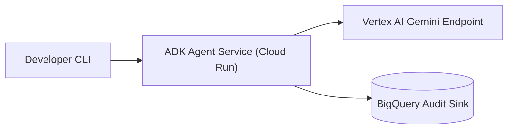

# Codelab: [Workshop Title]

- **Duration:** 45 minutes
- **Level:** Intermediate / Advanced
- **Target Persona:** Cloud Architects, AI Engineers, Platform Teams

---

## 1. Overview & Architecture

### What You Will Build
[1-paragraph summary of the end-to-end system the learner will deploy and verify.]



### Prerequisites
- Google Cloud project with billing enabled
- `gcloud`, `terraform` (`>= 1.6`), and `python3` (`>= 3.11`) installed

---

## 2. Environment Setup (Duration: 5m)

Export all shared environment variables once before running lab steps:
```bash
export PROJECT_ID="your-gcp-project-id"
export REGION="europe-west3"
export SERVICE_NAME="fde-agent-workshop"

gcloud config set project "${PROJECT_ID}"
gcloud config set compute/region "${REGION}"
```

### Checkpoint
Verify your active project and region:
```bash
gcloud config get-value project
# Expected output: your-gcp-project-id
```

---

## 3. Step 1: [Foundation & IAM Provisioning] (Duration: 15m)

### Concept
[Concise 2-sentence explanation of why this resource is configured this way.]

### Action
```bash
gcloud iam service-accounts create "${SERVICE_NAME}-sa" \
  --display-name="Workshop Agent Runtime Service Account"
```

### Checkpoint
Confirm the service account exists:
```bash
gcloud iam service-accounts list --filter="email ~ ${SERVICE_NAME}-sa"
```

---

## 4. Step 2: [Deploy & Invoke Workload] (Duration: 20m)

### Concept
[Concise explanation of the runtime deployment and verification step.]

### Action
```bash
# Run deployment command using exported variables
echo "Deploying ${SERVICE_NAME} to ${REGION}..."
```

### Checkpoint
Verify the HTTP health check returns `200 OK`:
```bash
# Expected output: {"status": "healthy"}
```

---

## 5. Cleanup & Resource Teardown (Duration: 5m)

Always delete workshop resources to prevent ongoing cloud charges:
```bash
gcloud iam service-accounts delete "${SERVICE_NAME}-sa@${PROJECT_ID}.iam.gserviceaccount.com" --quiet
```

### Checkpoint
Confirm zero workshop resources remain active.
