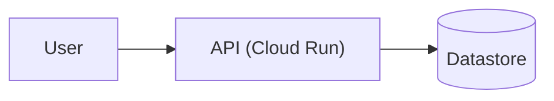

# Spec: [Project / Feature Name]

> Status: Draft | Approved | Superseded. Owner: [name]. Last updated: [YYYY-MM-DD].

## 1. Objective & Non-Goals
- **Problem:** [One sentence: what is broken or missing today, and for whom.]
- **Target user:** [Specific persona or team.]
- **Out of Scope / Not Doing:**
  - [Excluded capability] - [why it is excluded from this spec]

## 2. Success Criteria
- [ ] **Functional:** [Specific, testable behavior]
- [ ] **Performance / SLA:** [e.g., p95 latency < 1.5s, 0 unhandled tool exceptions]
- [ ] **Security / Compliance:** [e.g., least-privilege IAM, no hardcoded secrets, regional endpoint pinning]

## 3. Architecture, Data Flow & Tech Stack

- **Language / Framework:** [...]
- **Infrastructure / Cloud Services:** [...]
- **Key Dependencies (pinned versions):** [...]
- **API / Schema Contracts:** [Request/response shapes, event schemas, or table DDL.]
- **State Model:** [Where state lives, who mutates it, and how it is recovered.]

## 4. Executable Commands
```bash
# Setup / Install
...
# Unit & Integration Tests
...
# Static Verification / Lint
...
```

## 5. Project Structure & Interfaces
```text
src/           -> Core implementation
tests/         -> Automated test suite
docs/          -> Architecture & ADRs
```

## 6. Three-Tier Boundaries
- **Always do:** Run tests and static verification before committing; validate inputs at boundaries.
- **Ask first:** Adding new external dependencies, changing schemas, or modifying IAM/network policies.
- **Never do:** Commit credentials/PII, weaken existing tests, or modify out-of-scope modules.

## 7. Milestone DAG
- [ ] **M1: [Foundation / Core Contract]** (`Depends on: none`, `[SEQUENTIAL]`, size `S`)
  - **Files:** `...`
  - **Acceptance:** `...`
  - **Verify:** `...`
- [ ] **M2: [Core Implementation]** (`Depends on: M1`, `[PARALLEL]` with M3, size `M`)
  - **Files:** `...`
  - **Acceptance:** `...`
  - **Verify:** `...`

## 8. Open Questions
- [ ] [Any unresolved decision requiring human sign-off]
