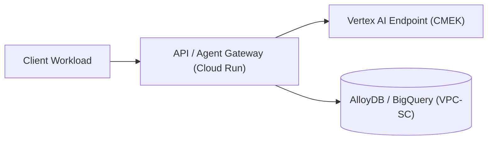

# Technical Design Document (TDD): [System / Feature Name]

- **Authors:** [Names]
- **Status:** Draft | Approved | Implemented
- **Last Updated:** YYYY-MM-DD
- **Related Spec / ADRs:** [Links to `docs/specs/...` and `docs/adr/...`]

---

## 1. Context & Scope
[Summarize the engineering problem, scale constraints, and why the current architecture cannot satisfy the requirement.]

### Goals
- [Goal 1 with concrete target: e.g., 500 QPS sustained at p99 < 400ms]
- [Goal 2]

### Non-Goals
- [Non-Goal 1]
- [Non-Goal 2]

---

## 2. System Architecture & Data Flow

### Component Responsibilities
1. **[Component A]:** [Responsibility, inputs, outputs, state]
2. **[Component B]:** [Responsibility, inputs, outputs, state]

---

## 3. API & Schema Contracts
[Define request/response schemas, protobuf/JSON payloads, database tables, and idempotency keys.]

---

## 4. Security, IAM & Data Sovereignty
- **Trust Boundaries:** [Where untrusted user or LLM inputs enter the system and how they are validated]
- **IAM & Identity:** [Service accounts, Workload Identity Federation, resource-scoped roles]
- **Network & Encryption:** [Private Google Access, VPC-SC ingress/egress rules, Cloud KMS key rotation]

---

## 5. Reliability, Observability & Rollback
- **SLIs / SLOs:** [Latency, availability, and error budget]
- **Failure Modes & Retries:** [Timeouts, circuit breakers, dead-letter queues]
- **Rollback Procedure:** [Exact steps to revert traffic, state, or Terraform changes in <5 minutes]

---

## 6. Alternatives Considered
| Alternative | Pros | Cons / Why Rejected |
| :--- | :--- | :--- |
| **[Option A]** | [Pros] | [Why rejected] |
| **[Option B]** | [Pros] | [Why rejected] |
