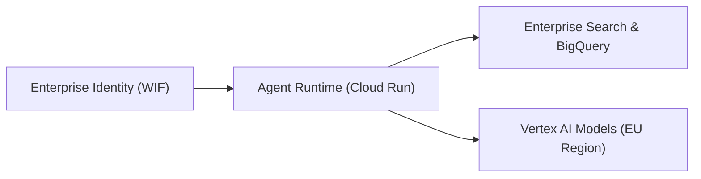

# Executive Architecture Readout: [Customer / Engagement Name]

- **Date:** YYYY-MM-DD
- **Prepared By:** [Name, Forward Deployed Engineering]
- **Audience:** [Executive Sponsor, CISO, VP of Engineering]

---

## 1. Headline Outcomes
- **Primary Business Impact:** [e.g., Cut end-to-end claims processing turnaround by **68%** (maintaining **99.4%** policy compliance across 50,000 daily transactions).]
- **Security & Sovereignty Posture:** [e.g., Deployed 100% inside an enforced EU Sovereign VPC Service Controls perimeter with customer-managed encryption keys.]
- **Production Readiness:** [e.g., Passed 3x peak load testing and automated evaluation gates across 500 golden test cases.]

---

## 2. Architecture Overview

- **Zero Standing Credentials:** All external workloads authenticate via short-lived OIDC tokens mapped through Workload Identity Federation.
- **Deterministic Guardrails:** Every model output is validated against strict JSON schemas and policy checks before downstream execution.

---

## 3. Measured Benchmarks & Evaluation Results

| Metric | Baseline | Measured Result | Target SLO | Status |
| :--- | :---: | :---: | :---: | :---: |
| **End-to-End Latency (p95)** | 18.4s | **2.1s** | <= 3.0s | PASS |
| **Golden Dataset Accuracy** | 71.0% | **96.8%** | >= 95.0% | PASS |
| **Unit Cost per 1k Requests** | \$14.20 | **\$1.85** | <= \$2.50 | PASS |

---

## 4. Production Handover & Next 30-60-90 Day Roadmap
- **Days 1–30 (Shadow Mode):** Run parallel shadow traffic on 10% of production volume and monitor drift dashboards.
- **Days 31–60 (Gradual Cutover):** Ramp production traffic from 25% to 100% with automated rollback alerts.
- **Days 61–90 (Continuous Evaluation):** Enable weekly golden dataset expansion from flagged edge cases.
